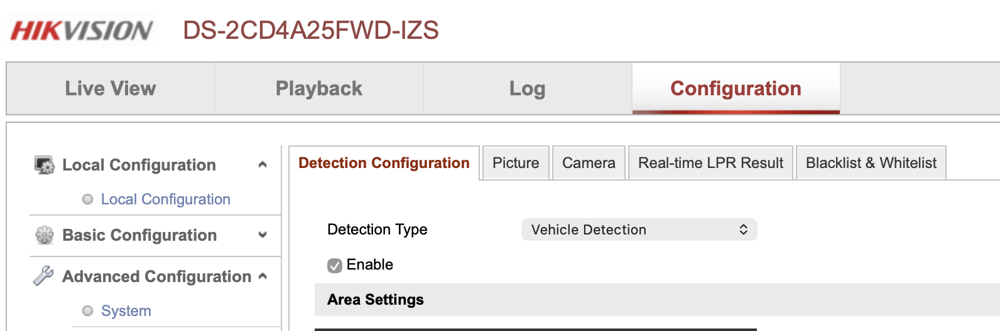
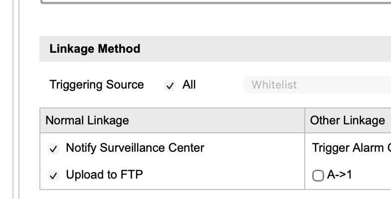
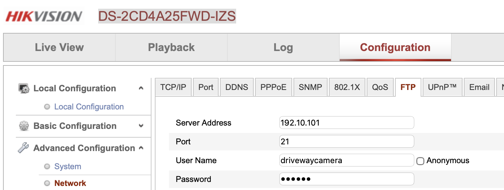
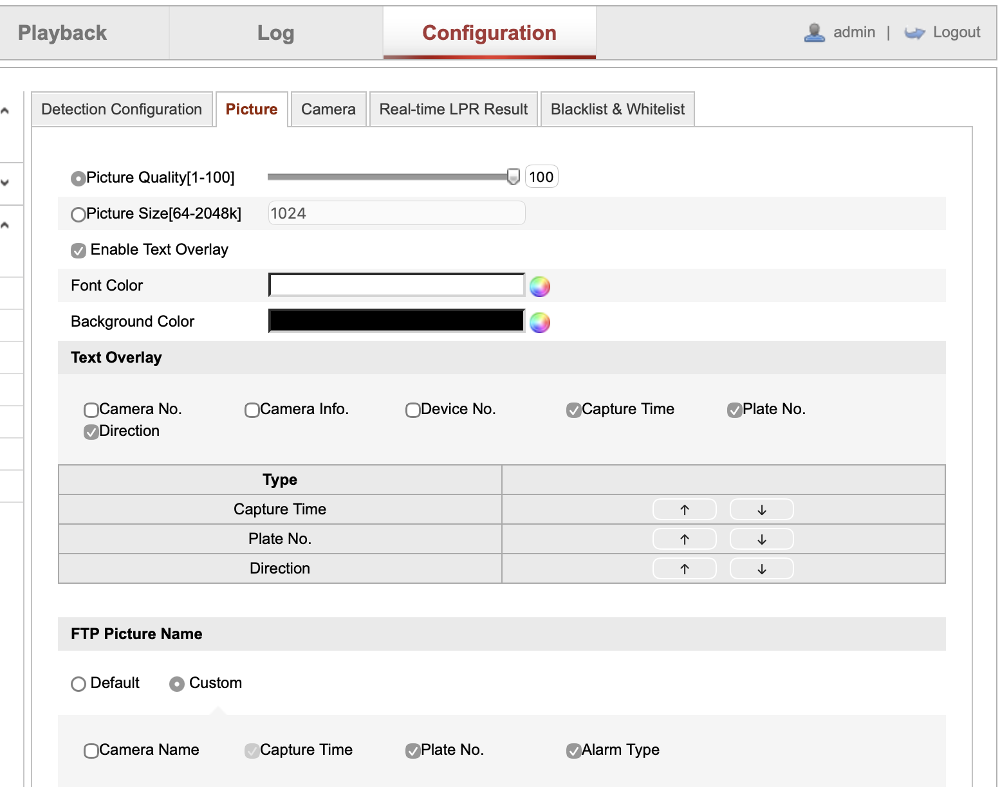
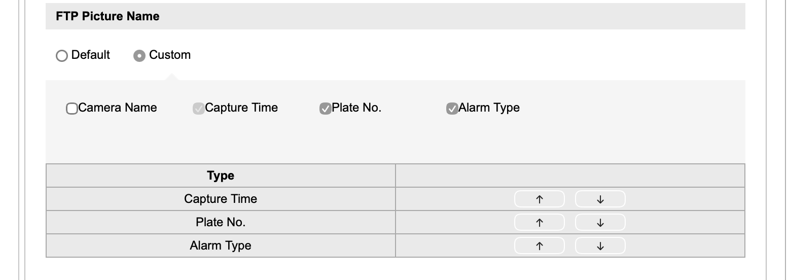
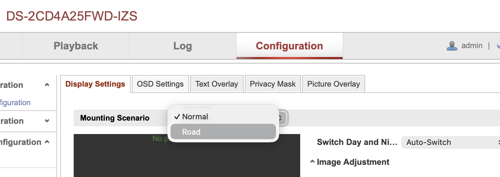
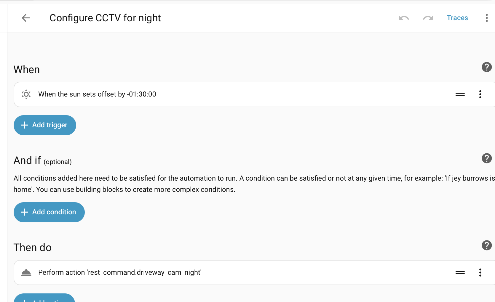

# Camera Configuration

Any camera that can upload an image for an event, by ftp, to a NAS or otherwise, with a timestamp in its file name, can
be used with `anpr2mqtt`. ANPR is its speciality, so the Hikvision ANPR camera below is the main example, followed by
[Other Events](#other-events), such as face capture and scene change, from the same or other cameras.

## Hikvision

### Example

This example uses the [DS-2CD4A25FWD-IZS](https://specsheets.dvs.co.uk/DS-2CD4A25FWD-IZS.pdf), one of the very first ANPR enabled Hikvision cameras, on its own, without any NVR.

ANPR configuration, including posting images via ftp, is configured in the *Road Traffic* menu under *Advanced*.

{width=500}

At the bottom of the page is the configuration for actions upon detecting a plate.

{width=500}

The server name, user name and password, and upload directory for this ftp are set once for all ftp actions in the *Network* menu under *Advanced Configuration*.

{width=500}

Some of the results of the recognition algorithm are available either on the picture and/or as part of the image file name. Direction is one that's only available with this model on the image. Its also possible to play with text colour here, although `anpr2mqtt` will optionally invert the colours pre-scan, so its possible to leave it as white text on black background to be clearer for humans to read.

{width=500}

The file name format is configurable, it should have the licence plate included and the timestamp to work with the default `anpr2mqtt` regular expression. There's no need to include camera number if there's only one ANPR camera.

{width=500}

### Image Settings

The Hikvision camera has a special set of image settings bundled as a **Mounting Scenario**

{width=500}

One side-effect of this is that the camera can be practically useless as a general purpose CCTV camera in anything other than very bright conditions if the *Road* Mounting Scenario is chosen.

One way of coping with this is to switch between mount scenarios, so its *Normal* at day time and *Road* at night, or have it on *Road* only when there is heightened security need.

#### Home Assistant Automated Mount Scenario Change

Set up two REST commands, changing `192.168.1.100` for the IP address or host name of your own camera, and adding `hik_user` and `hik_password` values to the `secrets.yaml` file (see [Storing Secrets](https://www.home-assistant.io/docs/configuration/secrets/)).

```title="REST Command Definitions"
driveway_cam_road:
    url: http://192.168.1.100/ISAPI/Image/channels/1/mountingScenario
    method: put
    content_type: text/xml
    username: !secret hik_user
    password: !secret hik_password
    payload: '<MountingScenario xmlns="http://www.hikvision.com/ver20/XMLSchema" version="2.0"><mode>road</mode></MountingScenario>'
  
driveway_cam_normal:
    url: http://192.168.1.100/ISAPI/Image/channels/1/mountingScenario
    method: put
    content_type: text/xml
    username: !secret hik_user
    password: !secret hik_password
    payload: '<MountingScenario xmlns="http://www.hikvision.com/ver20/XMLSchema" version="2.0"><mode>normal</mode></MountingScenario>'
```

These commands can now be used in Home Assistant automations as actions, triggered by time of day, state of sun etc.

{width=500}

## Other Events

Hikvision cameras have many other events besides ANPR, such as face capture, scene change, line crossing, region entry
or unattended baggage, and can ftp images for any of them. Any of these can be added as an event, so long as the camera
puts a timestamp in the file name, without anpr2mqtt having to know about each one.

As with ANPR, the file name format is set on the camera. For example, from camera IP address, channel and timestamp,
then the event's own name:

- `10.180.10.30_01_20261127071024588_SCENE_CHANGE_DETECTION.jpg`
- `10.180.10.40_01_20261125175413139_FACE_DETECTION.jpg`

Every event should have a `target_type`, `plate` for ANPR, and anything else for other events, along with an
`image_name_re` matching its file names. Leaving out `target_type` means `plate`, so that configurations from before
other events were supported still work. But that turns an event into a plate event, with a plate sensor and an empty
*Unknown vehicle* state, even on a camera with no ANPR. It can be on the same camera as an ANPR event, and share the same
`watch_path`, since each event only picks up files matching its own `image_name_re`.

```yaml
events:
- camera: shed
  event: anpr
  target_type: plate
  watch_path: /ftp/Shed
- camera: shed
  event: scene_change
  target_type: scene_change
  watch_path: /ftp/Shed
  image_name_re: (?P<ip>[0-9.]+)_(?P<channel>[0-9]+)_(?P<dt>[0-9]{17})_(?P<event>SCENE_CHANGE_DETECTION)\.(?P<ext>jpg|png|gif|jpeg)
  min_event_gap_seconds: 60
  ocr_field_ids: []
```

These events are kept apart from plates:

- **Home Assistant** gets an [event entity](https://www.home-assistant.io/integrations/event/), such as
  `event.scene_change_shed`, rather than a sensor, on the same device as the camera's ANPR sensor. Its `event_type` is
  the event's name, here `scene_change`, with the usual [attributes](homeassistant.md#attributes). There's also an
  image entity and a camera entity, as for ANPR
- **Integrations that take an anpr2mqtt device's sensors as plates**, such as
  [Camera AutoNotify](https://camera-autonotify.rhizomatics.org.uk), don't see them
- **No plate handling**: no DVLA lookup, plate correction or Frigate licence plates
- **Defaults**: none of the plate defaults. `event` is the `target_type`, so `event: scene_change` above could be left
  out, rather than `anpr`. `default_description` comes from the event name, here `Scene change`, rather than `Unknown
  vehicle`. `icon` is `mdi:cctv` rather than `mdi:car-back`. There's no OCR, rather than the Hikvision vehicle
  direction, so `ocr_field_ids: []` isn't needed

There's usually no `target` in these file names, so nothing to look up, correct or track, and the event entity
records when each was seen. Where a camera sends several images a second or so apart for the same thing,
`min_event_gap_seconds` makes them one event, publishing only the first within that many seconds of the last.

### Face Capture

Some cameras send two images per face: a `FACE_SNAP` cropped to the face, and a `FACE_BACKGROUND` of the whole scene,
a few milliseconds later, such as `10.180.10.20_01_20261120175018129_FACE_SNAP.jpg`. With `secondary_image_event`, the
`FACE_BACKGROUND` is published as a second image entity, such as `image.face_driveway_face_background`, rather than as
another event, so there's one event per face, with the `FACE_SNAP` as its image.

```yaml
- camera: driveway
  event: face
  target_type: face
  default_description: Face
  icon: mdi:face-recognition
  watch_path: /ftp/Driveway
  image_name_re: (?P<ip>[0-9.]+)_(?P<channel>[0-9]+)_(?P<dt>[0-9]{17})_(?P<event>FACE_SNAP|FACE_BACKGROUND)\.(?P<ext>jpg|png|gif|jpeg)
  secondary_image_event: FACE_BACKGROUND
  ocr_field_ids: []
```

Other cameras send only one image per face, `FACE_DETECTION`, often several a second or so apart. Match that event
name, leave out `secondary_image_event`, and set `min_event_gap_seconds`, such as `10`.

## Other ANPR Cameras

- See [Which Hikvision ANPR Camera Should I Buy in 2025?](https://www.use-ip.co.uk/forum/threads/which-hikvision-anpr-camera-should-i-buy-in-2025.12271/) FAQ from [use-IP Forum](https://www.use-ip.co.uk/forum/)

## Other Ways to Integrate

- Home Assistant built-in [Hikvision Integration](https://www.home-assistant.io/integrations/hikvision/) 
    - Has support for
'Surveillance Center' notifications but with open [issue #115631](https://github.com/home-assistant/core/issues/115631) for ANPR integration.