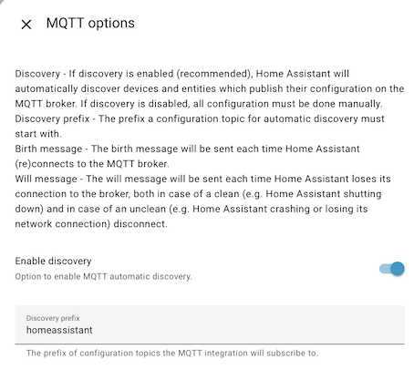
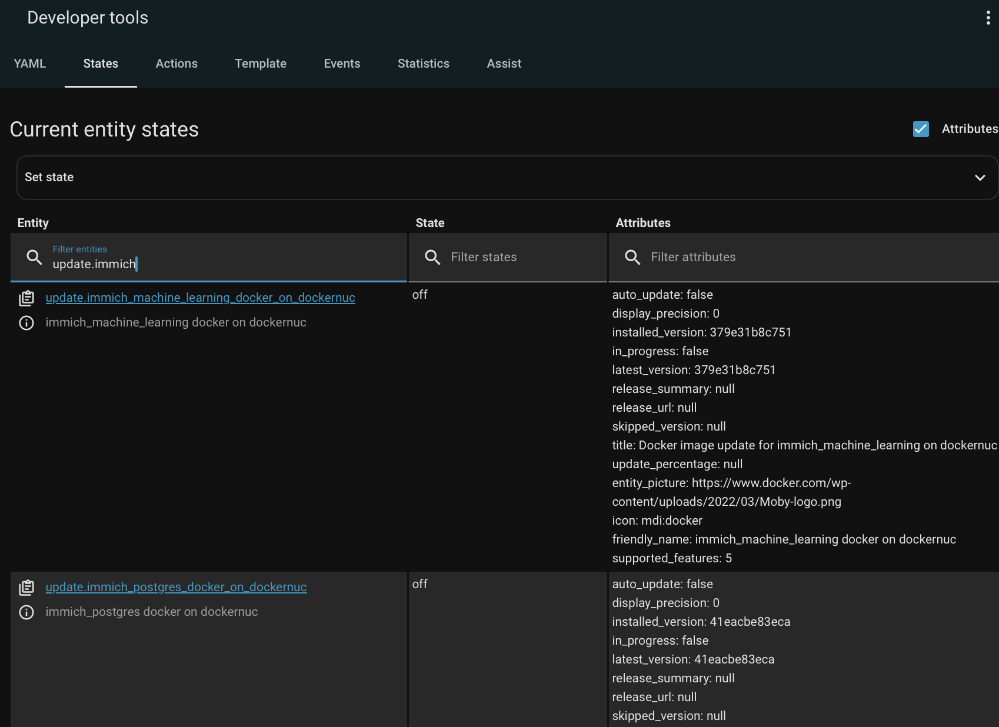
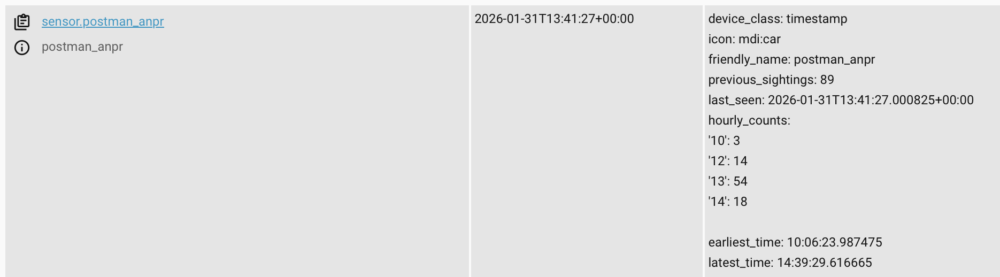

# HomeAssistant Integration

 `anpr2mqtt` represents each ANPR cameras as a [MQTT Sensor](https://www.home-assistant.io/integrations/sensor.mqtt/) and [MQTT Image](https://www.home-assistant.io/integrations/image.mqtt/) entities, and uses [MQTT discovery](https://www.home-assistant.io/integrations/mqtt/#mqtt-discovery) so that HomeAssistant automatically picks up components discovered by ANPR2MQTT with zero configuration on HomeAssistant itself. 

 The MQTT image entity can be used in the same way as a `camera` entity, so can be included in mobile push, email etc notifications, or added to a Home Assistant dashboard. See the example below, or use [Supernotify](https://supernotify.rhizomatics.org.uk) camera support.

## Auto Notify

{width=100}

Use [Camera AutoNotify](https://camera-autonotify.rhizomatics.org.uk) to automatically set up notifications with **zero YAML** and **no automations** required. It will also do plate enrichment, such as by tracking previous sightings, corrections, ignoring, classifying as known, prioritizing based on plate and UK DVLA lookup.

## Attributes

Both the `sensor` and `image` attributes have the same extensive set of attributes. For events other than plates,
the event entity has them too, with `event_type` as the event's name, all from the event itself, so they're always
those of the event that changed its state, apart from [image counts](#image-counts), which are refreshed between
events.

The target value will also appear in a field named after `target_type`, for example, `plate` for
easier to read Home Assistant automations.

| Attribute               | Example                                                                                |
|-------------------------|----------------------------------------------------------------------------------------|
| target                  | J23TST                                                                                 |
| target_type             | plate                                                                                  |
| `target_type`           | J23TST                                                                                 |
| source                  | filesystem                                                                             |
| reg_info                | null                                                                                   |
| area                    | driveway                                                                               |
| camera                  | drivewacam                                                                             |
| linked_cameras          | `{"frigate": "driveway"}`, the same camera in other integrations, by domain             |
| orig_target             | J23TST                                                                                 |
| ignore                  | false                                                                                  |
| known                   | true                                                                                   |
| dangerous               | false                                                                                  |
| priority                | medium                                                                                 |
| description             | Amazon Prime                                                                           |
| history.previous_sightings | 15                                                                                  |
| history.last_seen       | 2026-01-08T14:15:28.000319+00:00                                                       |
| event_time              | 2026-01-08T14:15:28.000320+00:00                                                       |
| event_image_url         | http://192.168.10.10/cctv//ftp/Driveway/20260108141528320_J23TST_VEHICLE_DETECTION.jpg |
| image_event             | VEHICLE DETECTION                                                                      |
| ext                     | jpg                                                                                    |
| image_size              | 124907                                                                                 |

The `reg_info` will be populated with the licence plate API lookup, for example UK DVLA,
if provided.

Some attributes are only present for events from a particular source, since they don't apply to
the other. `source` is always `filesystem` or `frigate`, and can be used to tell which set to expect:

| Attribute          | Source     | Example                                                       |
|--------------------|------------|----------------------------------------------------------------|
| file_path          | filesystem | /ftp/Driveway/20260108141528320_J23TST_VEHICLE_DETECTION.jpg   |
| vehicle_direction  | filesystem (OCR field, if configured) | Forward                             |
| frigate_event_id   | frigate    | 1790171055.400738-28axk4                                       |
| frigate_ui_url     | frigate    | http://192.168.10.10:5000/events?id=1790171055.400738-28axk4   |
| frigate            | frigate    | `{"recognized_license_plate_score": 0.92}`                     |

`event_image_url` is populated for both sources, pointing directly at the event image (the
filesystem image on the local web server, or the Frigate event snapshot API), so notification
automations can rely on it regardless of which source raised the event.

## Example Automation

This example uses [Supernotify](https://supernotify.rhizomatics.org.uk) to generate multiple
alerts, such as email with ANPR image attachment, mobile push with the image and click through to
Frigate page, voice assistant announcement and sounding chimes. It can also be used with any of the built-in notification integrations, though without the same multiple-transport and media handling capabilities.

```yaml
--8<-- "examples/ha_automation.yaml"
```

## Configuration

In general, no configuration is needed, if Home Assistant is already running with MQTT, and the defaults haven't been changed.

Make sure `anpr2mqtt` is publishing to the same broker, the [MQTT Integration](https://www.home-assistant.io/integrations/mqtt/) is installed and automatic discovery is not disabled.



The `homeassistant` default topic prefix matches the default ANPR2MQTT config, if its changed in HomeAssistant, then the ANPR2MQTT config must be changed to match.


## Device Creation

A Home Assistant device will be created for each ANPR2MQTT camera, and Home Assistant
will then group the relevant entities together on this device page. Use `device_creation: false` in the 
`homeassistant` config block if you want to switch off this behaviour.

Every device has manufacturer `Rhizomatics` and model `anpr2mqtt`, so other integrations can tell for certain that
it's anpr2mqtt's, and its configuration URL is the camera's `live_url`, where that's an `http` or `https` address.

## MQTT Topics

There are 4 separate types of MQTT topic used for HomeAssisstant integration:

- *Config* to support auto discovery. 
    - A topic is created per camera, with a name like `homeassistant/sensor/driveway/anpr/config`. 
    - For events other than plates, an `event` entity instead, such as `homeassistant/event/driveway/face/config`, see [Other Events](camera.md#other-events)
    - Optionally a `image` and `camera` topic can be created
    - The `homeassistant` topic prefix can also be configured.
- *State* to report the last plate seen and attributes
    - `anpr2mqtt/camera_name/state`
    - `anpr2mqtt/camera_name/image`
    - For events other than plates, `anpr2mqtt/event/cameras/camera_name/event` fires the event entity, not retained
- *Availability* to show whether ANPR2MQTT itself is running
    - One topic per ANPR2MQTT instance, `anpr2mqtt/availability`, holding `online` or `offline`
    - See [Availability](#availability) below

## Image Counts

Each event's entities have an `images` attribute counting the images received, for the event itself, for all events of
its camera, and for all cameras, to check that cameras are still sending images:

```yaml
images:
  event:
    today: 3
    this_week: 17
    total: 412
    last_received: "2026-11-27T07:10:34.596000+00:00"
  camera:
    today: 5
    this_week: 26
    total: 1033
    last_received: "2026-11-27T07:10:34.596000+00:00"
  all:
    today: 41
    this_week: 230
    total: 9120
    last_received: "2026-11-27T08:02:11.120000+00:00"
```

Every image matching the event's `image_name_re` is counted, whether or not it's published: duplicates, ignored plates,
a face's background image, or images within `min_event_gap_seconds`. When an image isn't published, the last state is
republished with the new counts, with the state and `event_time` unchanged, so it isn't taken as a new sighting.
Days and weeks are in local time, weeks starting on Monday, and the counts are republished at midnight, so `today` goes
back to 0 even for a camera that sends nothing. Counts are kept in `image_stats.json` in the tracker's `data_dir`, so
they carry on across restarts. Images from Frigate aren't counted, only those from the file system.

For example, a template binary sensor for a camera that's sent nothing today:

```yaml
template:
  - binary_sensor:
      - name: Barn camera quiet
        device_class: problem
        state: "{{ (state_attr('event.face_barn', 'images') or {}).get('camera', {}).get('today', 0) == 0 }}"
```

## Availability

ANPR2MQTT publishes whether it is running to a retained availability topic,
`<topic_root>/availability`, by default `anpr2mqtt/availability`, and every entity's discovery
config points to it as its `availability_topic`.

- `online` is published whenever ANPR2MQTT connects or reconnects to the broker
- `offline` is published when it shuts down cleanly
- `offline` is also registered with the broker as the MQTT *last will*, so the broker publishes it
  if ANPR2MQTT crashes, is killed or loses its connection

While ANPR2MQTT is down, its entities show as *unavailable* in Home Assistant, rather than
showing the last plate seen as if it were current. They come back once it reconnects.

!!! note

    Before 1.2.0, entities kept their last state while ANPR2MQTT was down. Automations or
    dashboards that treat `unavailable` as an error may now see it during restarts and upgrades.


## Verifying it Works

Rather than wait for a container to need an update, you can check right away that
Home Assistant has recognized the ANPR entities.

From the [Entities View](https://www.home-assistant.io/docs/configuration/entities_domains/), or the
[Developer Tools](https://www.home-assistant.io/docs/tools/dev-tools/), filter
the entities by `anpr.` 

{width=640}

## Republishing on Home Assistant restart

Home Assistant's MQTT integration can publish the status of Home Assistant itself to
*birth* and *last will and testament* topics. Current default for this is `homeassistant/status`,
though older installations may have `hass/status` - if its non-default, override in the
config under `homeassistant: status_topic`.

## Individual or Group Sensors

A single target, a group, or any mix of groups and targets, can be given an `entity_id` and published to
Home Assistant as a sensor, with the state value being the last sighting timestamp, and the attributes
being the combined history of the targets.



## More Home Assistant information

- [MQTT Integration](https://www.home-assistant.io/integrations/mqtt/)
    - Includes setting up a MQTT broker, MQTT Discovery, and trouble-shooting
- [MQTT Sensor](https://www.home-assistant.io/integrations/sensor.mqtt/)
- [MQTT Image](https://www.home-assistant.io/integrations/image.mqtt/)
